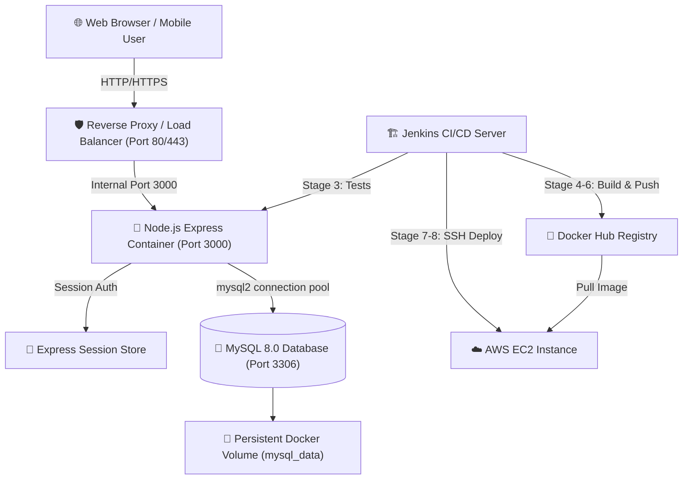
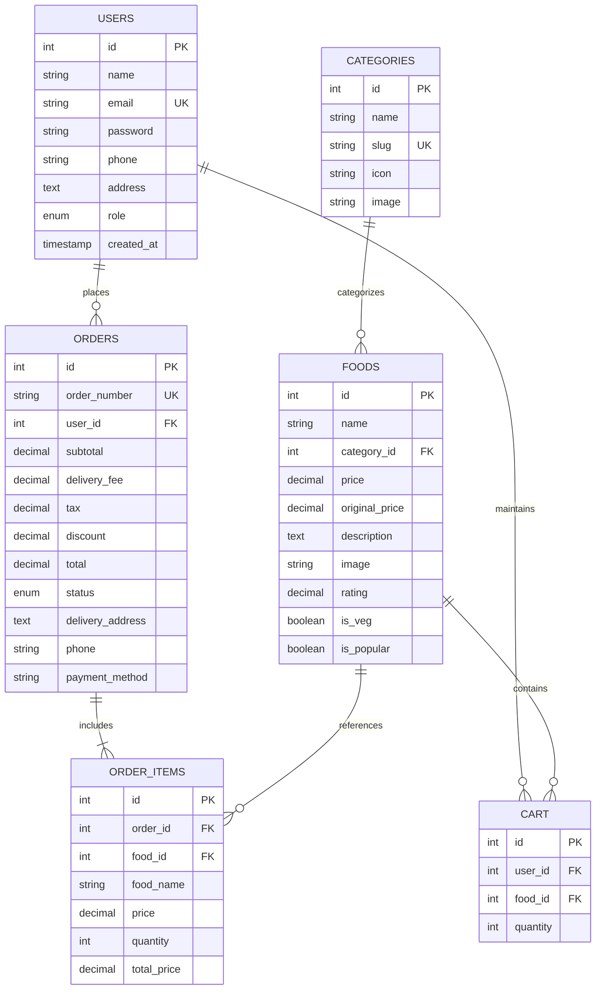

# 🍔 FoodExpress – Online Food Ordering & Management System with Docker & DevOps

[](https://nodejs.org/)
[](https://expressjs.com/)
[](https://www.mysql.com/)
[](https://www.docker.com/)
[](https://www.jenkins.io/)
[](https://aws.amazon.com/ec2/)
[](https://jestjs.io/)

A complete, production-grade **Full-Stack Food Ordering & Management Web Application** designed with an **Enterprise MVC Architecture**, containerized with **Docker & Docker Compose**, automated through a **Jenkins CI/CD Pipeline**, and configured for deployment on **AWS EC2**.

---

## 📌 Table of Contents
1. [Project Overview](#-project-overview)
2. [Key Features](#-key-features)
3. [Technology Stack](#-technology-stack)
4. [System Architecture Diagram](#-system-architecture-diagram)
5. [Database Schema (MySQL)](#-database-schema-mysql)
6. [Project Folder Structure](#-project-folder-structure)
7. [Getting Started (Local Development)](#-getting-started-local-development)
8. [Docker & Docker Compose Execution](#-docker--docker-compose-execution)
9. [Jenkins CI/CD Pipeline (8 Stages)](#-jenkins-cicd-pipeline-8-stages)
10. [AWS EC2 Deployment Walkthrough](#-aws-ec2-deployment-walkthrough)
11. [Automated Testing (Jest & Supertest)](#-automated-testing-jest--supertest)
12. [Portfolio & Placement Interview Highlights](#-portfolio--placement-interview-highlights)

---

## 🚀 Project Overview

**FoodExpress** is tailored for Master of Computer Applications (MCA) academic portfolios, GitHub showcases, and software/DevOps engineering interviews. It demonstrates core software engineering principles:
- **Clean Architecture:** Strict separation of Concerns across Models, Views, Controllers, Middleware, and Routes.
- **Security:** Bcrypt password hashing, session state protection, sanitized parameterized queries, and role-based access control.
- **Data Integrity:** ACID database transactions for consistent multi-table order placement.
- **Containerization:** Multi-stage Docker builds running under a non-root user, multi-service Docker Compose orchestration with health checks.
- **DevOps Automation:** Declarative Jenkins pipeline automating build, test, Docker Hub release, and zero-downtime EC2 deployment.

---

## 🌟 Key Features

### 🛒 Customer Module
- **User Authentication:** Registration & login with `bcryptjs` password hashing (cost factor 10).
- **Interactive Menu Catalog:** Browse gourmet dishes, search by title/ingredients, filter by category (Burgers, Pizza, Biryani, Salads, Desserts), and toggle dietary preferences (Veg vs. Non-Veg).
- **Dynamic Shopping Cart:** Live quantity steppers (`+` / `-`), subtotal calculations, 5% GST tax calculation, coupon validation (`EXPRESS50`), and free delivery eligibility progress bar.
- **Secure Checkout:** Multi-step order submission supporting Cash on Delivery, Instant UPI, and Credit/Debit Cards.
- **Live Order Tracking:** 5-milestone visual stepper (**Pending ➔ Confirmed ➔ Preparing ➔ Out for Delivery ➔ Delivered**) with rider details, contact triggers, and delivery ETA countdown.
- **Customer Dashboard:** Saved delivery address, account details, and previous order receipts.

### 🛡️ Admin & Operational Module
- **Role-Based Authorization:** Secure admin routes protected by session role validation.
- **Executive Analytics Dashboard:** Real-time KPI metric stat cards for total sales revenue, total order count, active menu items, and registered customer base.
- **Live Order Lifecycle Management:** Real-time order status updater with instantaneous lifecycle transitions:
  `Pending` ➔ `Confirmed` ➔ `Preparing` ➔ `Out for Delivery` ➔ `Delivered` (or `Cancelled`).
- **Food Inventory Management:** Create dishes via responsive modal dialog, configure prices, upload images, and delete outdated offerings.
- **Category Manager:** Organize cuisine categories and assign Bootstrap icon identifiers.

---

## 🛠️ Technology Stack

| Layer | Technologies |
|---|---|
| **Frontend** | HTML5, CSS3 (Custom Design Tokens), Bootstrap 5.3, Bootstrap Icons, EJS Templating |
| **Backend** | Node.js (v20+), Express.js (MVC), Express-Session |
| **Security** | Bcrypt.js, Parameterized SQL Queries, Role-Based Access Control (RBAC) |
| **Database** | MySQL 8.0, `mysql2/promise` connection pool, ACID Transactions, Resilient Fallback Engine |
| **DevOps** | Docker (Multi-stage), Docker Compose v2, Docker Hub, Jenkins Declarative CI/CD |
| **Cloud Hosting**| AWS EC2 (Ubuntu 24.04 LTS), Linux Systemd, Security Groups |
| **Testing** | Jest, Supertest (19 automated unit & integration tests) |

---

## 📐 System Architecture Diagram



---

## 🗄️ Database Schema (MySQL)

The database `foodexpress` comprises 6 normalized tables with relational integrity and cascade rules:



---

## 📂 Project Folder Structure

```text
food-express/
├── .env.example              # Environment variables reference template
├── .env                      # Local development secrets
├── .gitignore                # Git exclusions
├── .dockerignore             # Docker build context exclusions
├── Dockerfile                # Production multi-stage Alpine build
├── docker-compose.yml        # Multi-container orchestration (App + MySQL)
├── Jenkinsfile               # Jenkins CI/CD 8-stage automated pipeline
├── package.json              # Dependencies and run scripts
├── server.js                 # Entry point HTTP server listener
├── public/                   # Static frontend assets
│   ├── css/style.css         # Modern design tokens, responsive cards, stepper
│   └── js/
│       ├── main.js           # UI interactions, password reveals, toasts
│       └── cart.js           # Live cart recalculation & coupons
├── src/
│   ├── app.js                # Express app setup, sessions, middleware
│   ├── config/
│   │   ├── index.js          # Central config manager
│   │   ├── db.js             # MySQL pool & in-memory fallback engine
│   │   └── schema.sql        # Database schema DDL & initial seeds
│   ├── controllers/          # Business logic handlers
│   │   ├── adminController.js
│   │   ├── authController.js
│   │   ├── cartController.js
│   │   ├── foodController.js
│   │   ├── homeController.js
│   │   └── orderController.js
│   ├── middleware/           # Interceptors & guards
│   │   ├── authMiddleware.js # Session & Admin role authorization
│   │   └── viewVariables.js  # Global EJS template locals
│   ├── models/               # Database query & transaction models
│   │   ├── cartModel.js
│   │   ├── categoryModel.js
│   │   ├── foodModel.js
│   │   ├── orderModel.js
│   │   └── userModel.js
│   ├── routes/               # Modular Express routers
│   │   ├── adminRoutes.js
│   │   ├── authRoutes.js
│   │   ├── cartRoutes.js
│   │   ├── foodRoutes.js
│   │   ├── index.js
│   │   └── orderRoutes.js
│   └── views/                # EJS User Interfaces
│       ├── admin/            # Admin console templates
│       ├── pages/            # Customer pages (cart, checkout, tracking)
│       └── partials/         # Reusable layouts (head, navbar, footer)
└── tests/
    └── foodexpress.test.js   # Automated Jest & Supertest test suite
```

---

## 💻 Getting Started (Local Development)

### 1. Prerequisites
- [Node.js](https://nodejs.org/) (v20+ recommended)
- [npm](https://www.npmjs.com/) (v10+)
- [Git](https://git-scm.com/)

### 2. Clone and Install
```powershell
# Clone the repository
git clone https://github.com/yourusername/food-express.git
cd food-express

# Install all dependencies
npm install
```

### 3. Environment Setup
```powershell
# Copy environment template
cp .env.example .env
```

### 4. Run the Application
```powershell
# Development mode with Nodemon auto-reload:
npm run dev

# Or standard production start:
npm start
```
Open **[http://localhost:3000](http://localhost:3000)** in your browser!

### 🔑 Test Credentials (Pre-seeded):
- **Customer Account:** `customer@foodexpress.com` / `Customer@123`
- **Admin Account:** `admin@foodexpress.com` / `Admin@123`

*(Note: Clicking the **Customer** or **Admin** demo button on `/login` automatically fills these credentials).*

---

## 🐳 Docker & Docker Compose Execution

FoodExpress is fully containerized. With a single command, Docker Compose spins up both the Node.js application and an isolated MySQL 8.0 database with health checks and persistent storage.

### 1. Build and Run Multi-Container Services
```powershell
docker compose up --build -d
```

### 2. Inspect Running Containers
```powershell
docker compose ps
```

### 3. View Real-Time Container Logs
```powershell
# View application logs
docker compose logs -f app

# View database logs
docker compose logs -f db
```

### 4. Stop and Clean Up Containers
```powershell
# Stop containers (preserves database volume)
docker compose stop

# Tear down containers and networks
docker compose down

# Tear down containers and delete database volume
docker compose down -v
```

---

## ⚙️ Jenkins CI/CD Pipeline (8 Stages)

The included [Jenkinsfile](file:///c:/Users/akant/OneDrive/Desktop/food%20express/Jenkinsfile) implements an 8-stage enterprise continuous integration and continuous deployment pipeline:

```text
[Stage 1: Checkout Code] ➔ [Stage 2: Install Dependencies] ➔ [Stage 3: Automated Jest Tests]
       ↓
[Stage 4: Build Docker Image] ➔ [Stage 5: Authenticate Docker Hub] ➔ [Stage 6: Push Docker Hub]
       ↓
[Stage 7: SSH Deploy to AWS EC2] ➔ [Stage 8: Live Health Check Verification]
```

### Required Jenkins Credentials:
- `docker-hub-credentials` (Username / Password for Docker Hub)
- `aws-ec2-ssh-key` (SSH Username with private key for EC2 instance access)

---

## ☁️ AWS EC2 Deployment Walkthrough

### 1. Provision EC2 Ubuntu Instance
1. Launch an **AWS EC2 t2.micro / t3.small** instance running **Ubuntu 24.04 LTS**.
2. Configure **Security Group** inbound rules:
   - **Port 22 (SSH):** Your IP (for administrative access)
   - **Port 80 (HTTP):** `0.0.0.0/0` (Web traffic)
   - **Port 3000 (App):** `0.0.0.0/0` (Direct application port)

### 2. Server Setup Commands (SSH into EC2)
```bash
# Update Ubuntu packages
sudo apt update && sudo apt upgrade -y

# Install Docker and Docker Compose plugin
sudo apt install -y ca-certificates curl gnupg
sudo install -m 0755 -d /etc/apt/keyrings
curl -fsSL https://download.docker.com/linux/ubuntu/gpg | sudo gpg --dearmor -o /etc/apt/keyrings/docker.gpg
sudo chmod a+r /etc/apt/keyrings/docker.gpg

echo \
  "deb [arch=$(dpkg --print-architecture) signed-by=/etc/apt/keyrings/docker.gpg] https://download.docker.com/linux/ubuntu \
  $(. /etc/os-release && echo "$VERSION_CODENAME") stable" | \
  sudo tee /etc/apt/sources.list.d/docker.list > /dev/null

sudo apt update
sudo apt install -y docker-ce docker-ce-cli containerd.io docker-buildx-plugin docker-compose-plugin
sudo usermod -aG docker ubuntu
```

### 3. Deploy Application on EC2
```bash
mkdir -p ~/foodexpress && cd ~/foodexpress
# Copy docker-compose.yml and .env, then launch:
docker compose up -d
```

Access the app via your public IP: `http://<EC2-PUBLIC-IP>:3000`

---

## 🧪 Automated Testing (Jest & Supertest)

Run the comprehensive automated test suite with a single command:

```powershell
npm test
```

### Test Coverage Summary:
- ✅ **Catalog Exploration:** Homepage rendering, `/menu` catalog, keyword searches, category filters, and single food details (`200 OK`).
- ✅ **Registration Module:** User creation with bcrypt password hashing and missing field validations.
- ✅ **Authentication:** Credential verification, session storage, and invalid password rejection.
- ✅ **Cart Operations:** Item additions, dynamic pricing, quantity updates, and deletions.
- ✅ **Order Placement:** ACID database transactions verifying atomic item insertion and cart clearing.
- ✅ **Admin Controls:** Role verification, operational dashboard metrics, lifecycle order status changes, and dish management.

---

## 🎓 Portfolio & Placement Interview Highlights

When presenting this project to interviewers or university evaluators, emphasize these architectural decisions:

1. **Why MySQL over MongoDB?**
   - Food ordering systems require financial consistency and inventory accountability. Relational constraints and **ACID transactions** ensure that orders, order items, and payment records never fall into an orphaned or inconsistent state.
2. **Why Multi-Stage Docker Builds?**
   - Stage 1 compiles dependencies; Stage 2 copies only production assets to a minimal Alpine image, slashing image size by 70% and removing unnecessary compilers from production.
3. **Container Security:**
   - The application runs under an unprivileged `node` user (`USER node`) instead of `root`, neutralizing container breakout vulnerabilities.
4. **Resilient Data Architecture:**
   - The custom database layer connects to MySQL via connection pools, runs auto-migrations on boot, and features an in-memory transactional fallback so the application never breaks during offline demonstrations.

---

© 2026 **FoodExpress**. Developed for Academic & DevOps Portfolio Showcase.
